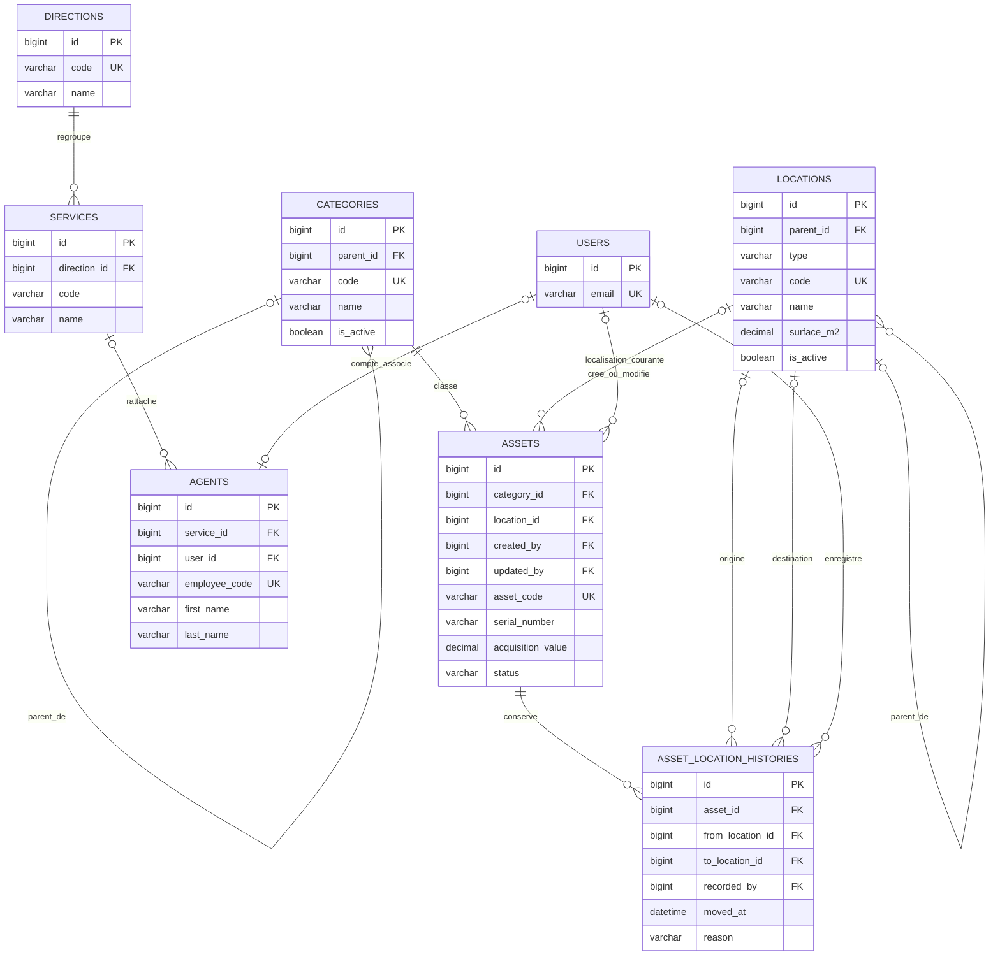

# Schéma des relations

## Socle implémenté



`o|` indique une relation facultative côté enfant lorsqu'une FK est nullable.
L'arbre `locations` est limité aux niveaux `site > building > room` par validation
du modèle ; l'arbre `categories` est limité à catégorie > sous-catégorie.

## Relations métier prévues — non migrées

```text
Supplier 1 ── N PurchaseOrder 1 ── N PurchaseOrderLine
PurchaseOrderLine 1 ── N ReceiptLine N ── 1 Receipt
PurchaseOrderLine 1 ── N InvoiceLine N ── 1 Invoice
ReceiptLine 1 ── N Asset (lien à arrêter selon réception/numéros de série)

Asset 1 ── N AssetAssignment ── 0..1 Agent
AssetAssignment ── exactement un Agent ou un Service
Asset 1 ── N DepreciationEntry ; DepreciationPlan 1 ── N DepreciationEntry
InventoryCampaign 1 ── N InventoryObservation N ── 0..1 Asset
InventoryCampaign N ── N User/Agent via InventoryTeamMember
Asset 1 ── N MaintenanceRequest 1 ── N MaintenanceIntervention
MaintenanceIntervention 1 ── N MaintenanceCostLine N ── 0..1 Supplier
Asset 1 ── 0..1 RealEstateDetail
Document N ── N domaine métier via tables de liaison à clés étrangères dédiées
User N ── N Role N ── N Permission ; AuditLog conserve les actions sans suppression
```

Les relations futures sont indicatives. Les clés, règles d'approbation, méthodes
comptables, statuts et contraintes de rétention doivent être validés avec l'ARTF
avant de créer ces tables.
